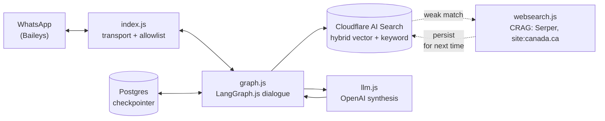

# ircc-whatsapp-bot

[](https://github.com/kattakath/ircc-whatsapp-bot/actions/workflows/ci.yml)
[](LICENSE)

WhatsApp bot answering Canadian immigration questions from official IRCC pages, retrieved via Cloudflare AI Search

It is informal, unpaid help, not a licensed immigration consulting tool: see
[Legal boundary](#legal-boundary) below.



## Background

- **Retrieval:** `src/db.js` searches a private Cloudflare AI Search instance for the IRCC page
  chunks closest to the question. The question leaves the machine here.
- **Web fallback (CRAG, Corrective RAG):** when retrieval is weak, `src/websearch.js` discards
  it and searches canada.ca live. It writes each page it fetched back to AI Search for next time.
- **Synthesis:** `src/llm.js` asks the OpenAI API to answer only from the retrieved content,
  with citations, formatted for WhatsApp.
- **Dialogue:** `src/graph.js` is a LangGraph.js `StateGraph`, checkpointed to Postgres, so a
  conversation survives a crash or a restart.
- **Transport:** `src/index.js` connects through [Baileys](https://github.com/WhiskeySockets/Baileys),
  an unofficial WhatsApp Web client.

More:

- [How it works, and why LangGraph](docs/explanation/architecture.md)
- [Configuration: environment variables and Nix options](docs/reference/configuration.md)
- [Run it as a Nix service](docs/how-to/run-as-a-nix-service.md)
- [Refresh the IRCC corpus](docs/how-to/refresh-the-corpus.md)

## Install

```sh
npm install
cp .env.example .env    # then fill it in
```

[`.env.example`](.env.example) is the authoritative list of environment variables. The required
ones are `OPENAI_API_KEY`, `CF_ACCOUNT_ID` and the AI Search token. On macOS the token can live
in the login Keychain instead: see [configuration](docs/reference/configuration.md).

With Nix, `nix build` builds the package and `nix develop` opens a dev shell. To run it as a
supervised service from another flake, see
[Run it as a Nix service](docs/how-to/run-as-a-nix-service.md).

## Usage

### Pair WhatsApp: use a spare number

Baileys links to a real WhatsApp account the same way **Linked Devices** does. It is **not** the
official WhatsApp Business API. It is an unofficial client, which is against WhatsApp's Terms
of Service, and Meta does detect and ban accounts that behave like automated clients. If the
linked number is someone's main number, a ban takes out their real WhatsApp too.

**Use a spare number or a secondary SIM.**

1. `npm start`. A QR code prints in the terminal. (Set `PAIR_PHONE_NUMBER` to pair with a
   phone-number code instead.)
2. On the spare-number phone: WhatsApp → Settings → **Linked Devices** → **Link a Device**, and
   scan the code.
3. `WhatsApp connected. Listening for messages...` means it worked. The session is saved to
   `auth/` (gitignored), so it stays linked across restarts.
4. Set `ALLOWED_NUMBERS` before it goes live. Unset, the bot replies to anyone who messages
   the linked number.

### Test without WhatsApp

```sh
npm test                                         # offline unit tests: fetch is mocked
node src/test-pipeline.js "How to come to Canada?"   # live: AI Search + OpenAI
node src/simulate.js "hi" "2" "1" "__RESTART__" "menu" "1" "2"
```

`simulate.js` runs a whole conversation. A message that is exactly `__RESTART__` simulates a
process crash: it compiles a fresh graph mid-conversation and checks the state survives.

### Legal boundary

In Canada, only **RCICs** (Regulated Canadian Immigration Consultants), lawyers or Quebec
notaries may legally give *paid* immigration advice or representation (IRPA s.91). This bot is
informal, unpaid help. Do **not** present it as professional or official advice, offer it to
others as a consulting service, or rely on it for anything that affects a real application
without checking canada.ca or a licensed professional.

The bot's answers are instructed to say this every time. The human framing around it (how it
is introduced, who gets access) is what actually keeps it on the right side of that line.

## Contributing

See [CONTRIBUTING.md](CONTRIBUTING.md). One required check, `gate`, must pass.

## License

[MIT](LICENSE)
